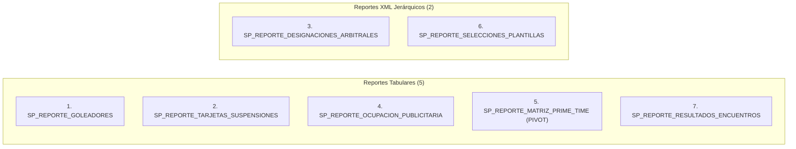

# Entrega 7: Reportes Oficiales del Torneo

**Universidad Nacional de La Matanza**  
**Departamento de Ingeniería e Investigaciones Tecnológicas**  
**Asignatura:** 3641 – Bases de Datos Aplicadas  
**Comisión:** 01-2900  
**Grupo:** 05  
**Docentes:** HNATIUK, JAIR EZEQUIEL; PALOMARES, LUIS ALFONSO  
**Fecha:** 24 de noviembre de 2026  

---

### Integrantes

| Alumno | DNI | Usuario de GitHub |
|---|---|---|
| Casella, Mateo Ezequiel | - | MateoCasella |
| Chungara Tenorio, Denis Abner | - | DenisChungara |
| Torczuk, Elías Alexei | - | alexxe1 |
| Canseco Carrizo, Yamil Simón | - | yamilscc |

---

## 1. Introducción y Alcance

El presente documento detalla la implementación técnica de la capa analítica de **Reportes Oficiales** correspondiente a la **Entrega 7** de la base de datos `MundialFutbol`.

Se desarrollaron **siete (7) Stored Procedures** en `scripts/creacion/30_SP_Reportes.sql`, implementados íntegramente en **T-SQL estático** (sin uso de SQL dinámico), combinando salidas tabulares, una matriz cruzada mediante `PIVOT` estático y dos estructuras jerárquicas en formato **XML** (`FOR XML PATH`).

---

## 2. Principios Técnicos de Implementación

* **T-SQL Estático (sin SQL dinámico):** Todos los procedimientos están precompilados de forma estática, respetando la pauta de la cátedra, eliminando riesgos de inyección SQL y optimizando la reutilización de planes de ejecución.
* **Tolerancia a datos parciales:** Mediante `LEFT JOIN`, `OUTER APPLY` e `ISNULL`, los reportes devuelven resultados consistentes aun cuando el torneo se encuentre en curso o existan partidos pendientes de disputa.
* **Filtros opcionales validados:** Todos los procedimientos admiten parámetros de filtrado con valor por defecto (`NULL` o `0`). Un filtro que no existe (selección, fase, sede, partido, árbitro, grupo o estado) se rechaza con un único mensaje que agrupa todos los problemas (`THROW 52000`), calculado por `nucleo.fn_ValidarFiltrosReporte`.
* **Datos cifrados:** Los nombres de árbitros y del cuerpo técnico se obtienen con `nucleo.fn_NombreArbitro` y `nucleo.fn_NombreStaff`, que la Entrega 8 redefine para descifrarlos. Los reportes muestran el nombre real sin que los usuarios de consulta tengan permiso para descifrar por su cuenta (ver Entrega 8).
* **Modelo de publicidad:** Anunciante 1-N Campania 1-N Pieza. Los ingresos son la tarifa guardada en cada `EspacioPublicitario` al asignarlo (lo facturado), no la tarifa vigente hoy.

---

## 3. Detalle de los 7 Reportes Implementados (`30_SP_Reportes.sql`)

### 3.1 `eventos.SP_REPORTE_GOLEADORES` (Tabular)
* **Parámetros:** `@codigoFIFA CHAR(3) = NULL`, `@idFase TINYINT = NULL`, `@incluirEnContra BIT = 0`.
* **Lógica:** Excluye los goles convertidos en `Definicion por Penales` (en coherencia con `eventos.fn_ResultadoPartido`). Desglosa por jugador y fase los goles según tipo (`Jugada`, `Cabezazo`, `Penal`, `Tiro Libre` y opcionalmente `En contra` sin sumarlos al total válido). Calcula asistencias, acumulados del torneo y puesto (`DENSE_RANK()`) mediante funciones ventana antes de aplicar los filtros opcionales.

### 3.2 `eventos.SP_REPORTE_TARJETAS_SUSPENSIONES` (Tabular)
* **Parámetros:** `@codigoFIFA CHAR(3) = NULL`, `@soloConSuspensionActiva BIT = 0`.
* **Lógica:** Contabiliza tarjetas amarillas, rojas por doble amarilla y rojas directas por selección y jugador. Determina si una suspensión por acumulación (`PartidosSuspension > 0`) sigue activa comparándola contra los partidos ya finalizados por su selección con posterioridad al encuentro de la tarjeta, e informa el próximo partido programado a cumplir (consistente con `eventos.fn_EstaSuspendido`).

### 3.3 `nucleo.SP_REPORTE_DESIGNACIONES_ARBITRALES` (XML #1)
* **Parámetros:** `@idArbitro SMALLINT = NULL`, `@idFase TINYINT = NULL`.
* **Estructura:** Genera un documento XML mediante `FOR XML PATH('Arbitro'), ROOT('DesignacionesArbitrales'), TYPE`. Incluye atributos de identificación y habilitación, país, categoría, idiomas agrupados con `STRING_AGG`, resumen de designaciones totales y como principal, y el detalle anidado de partidos junto con las amonestaciones/expulsiones señaladas cuando actuó como árbitro `Principal`.

### 3.4 `publicidad.SP_REPORTE_OCUPACION_PUBLICITARIA` (Tabular – 2 Result Sets)
* **Parámetros:** `@idSede TINYINT = NULL`, `@idPartido SMALLINT = NULL`, `@resultado TINYINT = NULL` (`NULL`: los dos result sets; `1`: solo el detalle; `2`: solo el resumen).
* **Lógica:**
  * *Result set 1:* Detalle espacio por espacio (`1` a `4`) de cada partido y sede: estado (`Ocupado`/`Libre`), anunciante, campaña, pieza, idioma, tarifa y moneda guardadas en el espacio, la tarifa convertida a USD, el criterio de asignación y el porcentaje de ocupación del encuentro.
  * *Result set 2:* Resumen de espacios ocupados e ingresos por **sede y moneda** (sin sumar importes de divisas distintas), más `IngresosUSD` y `TotalIngresosUSDSede`, convertidos con la cotización (base USD) más reciente a la fecha del partido.

### 3.5 `publicidad.SP_REPORTE_MATRIZ_PRIME_TIME` (Tabular – `PIVOT` Estático)
* **Parámetros:** `@idPartido SMALLINT = NULL`, `@idFase TINYINT = NULL`.
* **Lógica:** Tabla cruzada de partidos contra los **22 mercados del torneo** (los países del seed, con los códigos del modelo: ENG, NED, GER, SUI, CHI) mediante `PIVOT` estático, con `'SI (HH:MM)'` (hora local del mercado) o `'NO'`. `TotalMercadosPrimeTime` y `MercadosEnPrimeTimeDetalle` salen de `nucleo.fn_MercadosEnPrimeTime` y no dependen de la lista de columnas: un país nuevo se cuenta igual, y se agrega como columna editando el procedimiento (no se usa SQL dinámico). Con el seed, el partido 1 (ARG vs BRA, 23:00 UTC) está en prime time en 6 mercados.

### 3.6 `jugadores.SP_REPORTE_SELECCIONES_PLANTILLAS` (XML #2)
* **Parámetros:** `@codigoFIFA CHAR(3) = NULL`, `@grupo CHAR(1) = NULL`, `@incluirBajas BIT = 0`.
* **Estructura:** Serializa con `FOR XML PATH('Seleccion'), ROOT('SeleccionesYPlantillas'), TYPE` cada selección (`@CodigoFIFA`, `@Grupo`, país, confederación, ranking FIFA, condición de anfitrión y cantidad de convocados activos), incluyendo el cuerpo técnico y el vector anidado de jugadores convocados con nombre, posición, club y dorsal.

### 3.7 `nucleo.SP_REPORTE_RESULTADOS_ENCUENTROS` (Tabular)
* **Parámetros:** `@idFase TINYINT = NULL`, `@codigoFIFA CHAR(3) = NULL`, `@estado VARCHAR(10) = NULL`.
* **Lógica:** Muestra el fixture completo con fecha/hora UTC y su conversión a hora local de la sede (`AT TIME ZONE`), instancia (grupo o eliminación directa), marcador reglamentario y de penales, selección ganadora, concurrencia, porcentaje de ocupación del estadio y árbitro principal designado.

---

## 4. Validación y Testing (`30_Test_SP_Reportes.sql`)

La verificación se implementó en `scripts/testing/30_Test_SP_Reportes.sql`, integrado en `00_Ejecutar_Tests.sql`. Cada caso imprime `OK` o `FALLÓ` comparando el reporte con lo que dicen las tablas (cantidad de filas o de nodos XML, totales de goles, tarjetas e ingresos), verifica que los dos XML tengan su raíz y no muestren nombres enmascarados, y que cada reporte rechace un filtro inexistente con un mensaje agrupado. Sin datos cargados, los casos que los necesitan se informan como `OMITIDO`.

Resultado con los seeds cargados (`importacion/00_Cargar_Seeds.sql`): goleadores 13 filas (26 goles válidos), tarjetas de 4 jugadores (7 tarjetas), designaciones 18 árbitros y 120 designaciones, ocupación 96 espacios ocupados de 96, matriz de 24 partidos (partido 1 en 6 mercados), plantillas 16 selecciones y 368 convocados, resultados 24 partidos finalizados.

---

## 5. Resumen de Archivos Incorporados al Repositorio

| Carpeta | Archivo | Descripción |
|---|---|---|
| `scripts/creacion/` | `30_SP_Reportes.sql` | Implementación en T-SQL estático de los 7 reportes oficiales (5 tabulares + 2 XML). |
| `scripts/testing/` | `30_Test_SP_Reportes.sql` | Verificación automática (OK/FALLÓ) de los 7 reportes, sus filtros y la validez de los XML. |
| `doc/entrega7/` | `entrega7_reportes_oficiales.md` | Documento técnico formal de la Entrega 7 (Reportes Oficiales). |
