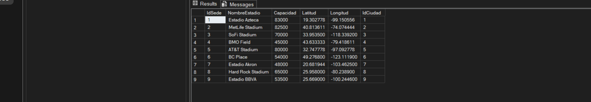
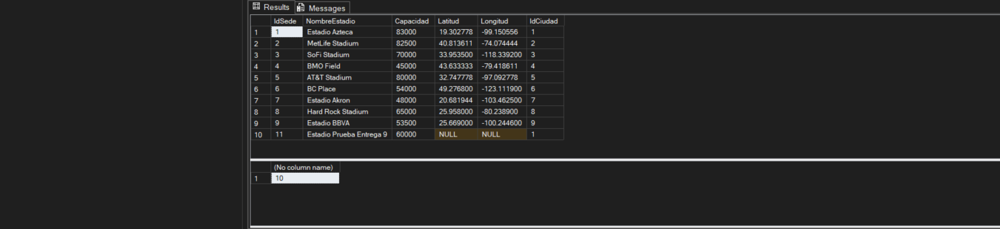
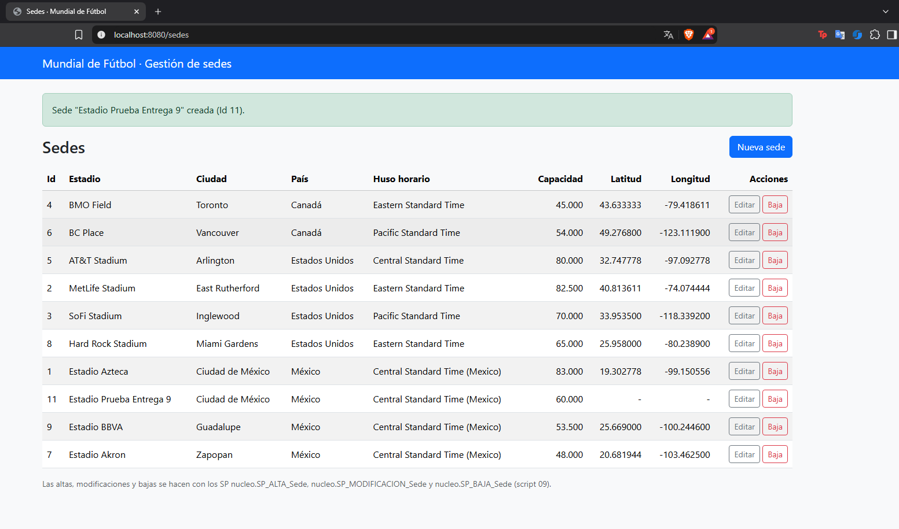
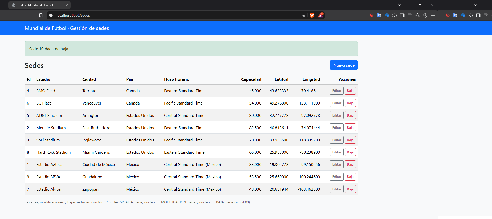

# Entrega 9 – Consultas, aplicación de ABM y tablero de BI

Esta entrega integra el trabajo de las entregas anteriores en tres piezas que se usan desde afuera de SQL Server:

| Pieza | Qué es | Dónde está |
|---|---|---|
| **Consultas de "To BE"** | Vistas y un procedimiento de consulta que responden lo que pide la sección *To BE* del enunciado (fixture, goleadores, tarjetas, árbitros, publicidad, mapa de sedes) | `scripts/creacion/34_Consultas_ToBe.sql` y su test `scripts/testing/34_Test_Consultas_ToBe.sql` |
| **Aplicación de ABM** | Aplicación web (Java, Spring Boot) que da de alta, modifica y da de baja sedes | `app/` |
| **Tablero de BI** | Tablero de Power BI conectado a la base, con gráficos y un mapa de sedes | `doc/entrega9/Mundial.pbix` y capturas en `doc/entrega9/capturas/` |

## Qué integra

- **Entrega 5 (base de datos y lógica de negocio).** La aplicación no escribe en ninguna tabla: toda alta, modificación y baja pasa por los procedimientos `nucleo.SP_ALTA_Sede`, `nucleo.SP_MODIFICACION_Sede` y `nucleo.SP_BAJA_Sede` (script 09). Cuando un procedimiento rechaza una operación, la aplicación muestra su mensaje consolidado, con una condición incumplida por renglón.
- **Entrega 6 (importación).** Los datos que se ven en las consultas, en el tablero y en la aplicación (sedes, ciudades, 24 partidos, PBI per cápita, cotizaciones y pauta publicitaria) se cargan con los scripts de `scripts/importacion/`.
- **Entrega 7 (reportes).** Las vistas del script 34 sirven como base de los reportes de goleadores, tarjetas, designaciones arbitrales, ocupación publicitaria y prime time.

## 1. Consultas de "To BE" (script 34)

| Requisito del enunciado | Objeto que lo cubre |
|---|---|
| Fixture completo, filtrable por sede, fase, selección o fecha | `nucleo.SP_CONSULTAR_FIXTURE` (todos los filtros son opcionales) y `nucleo.vw_Fixture` |
| Resultado de cada partido | `nucleo.vw_PartidoResultado`, que lee el resultado de `eventos.fn_ResultadoPartido` (el resultado se deriva de los goles y no se guarda en `Partido`) |
| Tabla de goleadores del torneo y por selección | `eventos.vw_Goleadores` |
| Historial de titularidad de cada jugador | `jugadores.vw_HistorialTitularidad` |
| Equipo en cancha en cualquier minuto | `jugadores.fn_JugadoresEnCancha` (script 14) |
| Tarjetas por selección y jugador, con suspensión activa | `eventos.vw_TarjetasPorSancionado` |
| Partidos dirigidos por cada árbitro, con sus sanciones | `nucleo.vw_HistorialArbitral` |
| Publicidad exhibida por partido, con la tarifa convertida a USD | `publicidad.vw_EspaciosPublicitariosUSD` |
| Ocupación e ingresos publicitarios por sede | `publicidad.vw_OcupacionPublicitariaSede` |
| Simulación de prime time por mercado | `nucleo.fn_MercadosEnPrimeTime` (script 07) y `publicidad.vw_MercadosPrimeTimePorPartido` |
| Mapa de sedes (latitud y longitud) | `nucleo.vw_SedesMapa` |
| Clasificados al terminar la fase de grupos | `nucleo.SP_CALCULO_DE_SELECCIONES_CLASIFICADAS` (script 27) |

**Cómo se prueba.** El test `34_Test_Consultas_ToBe.sql` arma sus propios datos de prueba (prefijo `TEST`), ejecuta cada consulta y compara con el resultado esperado, que está escrito como comentario en cada caso. Se ejecuta con el resto de los tests (ver "Cómo ejecutar las pruebas"). En la última corrida completa no hubo ningún caso con `FALLÓ` en el test 34.

## 2. Aplicación de ABM de sedes (`app/`)

**Tecnología:** Java 21, Spring Boot, Thymeleaf y Bootstrap. El acceso a la base usa solo `JdbcTemplate` y `SimpleJdbcCall`; no hay JPA, así que no existe ninguna escritura directa sobre las tablas.

**Pantallas:** listado de sedes (`/sedes`), formulario de alta (`/sedes/nueva`) y de modificación (`/sedes/{id}/editar`), y botón de baja con confirmación.

**Usuario de la base.** La aplicación se conecta con un usuario de SQL Server con permisos mínimos: puede leer `Sede`, `Ciudad` y `Pais`, y ejecutar solo los tres procedimientos de sede. No tiene permiso de escritura sobre ninguna tabla.

### Requisitos

- Java 21 (con `JAVA_HOME` configurado).
- SQL Server con TCP/IP habilitado en el puerto 1433 y autenticación mixta (SQL Server y Windows).
- La base `MundialFutbol` creada y con datos (ver "Carga de datos").

### Crear el usuario de la aplicación

Ejecutar en SSMS, reemplazando la contraseña por una propia (no se guarda en el repositorio):

```sql
CREATE LOGIN app_mundial WITH PASSWORD = '<contraseña-propia>';
GO
USE MundialFutbol;
CREATE USER app_mundial FOR LOGIN app_mundial;
GRANT SELECT ON nucleo.Sede TO app_mundial;
GRANT SELECT ON nucleo.Ciudad TO app_mundial;
GRANT SELECT ON nucleo.Pais TO app_mundial;
GRANT EXECUTE ON nucleo.SP_ALTA_Sede TO app_mundial;
GRANT EXECUTE ON nucleo.SP_MODIFICACION_Sede TO app_mundial;
GRANT EXECUTE ON nucleo.SP_BAJA_Sede TO app_mundial;
```

`00_Reset_Total.sql` borra la base y con ella este usuario: hay que volver a crearlo después de cada reinicio completo.

### Levantar la aplicación

La conexión se configura con variables de entorno, para no guardar credenciales en el repositorio. Desde la carpeta `app`:

```powershell
$env:DB_USER = "app_mundial"
$env:DB_PASSWORD = "<contraseña-propia>"
.\mvnw.cmd spring-boot:run
```

Por defecto se conecta a `localhost:1433`, base `MundialFutbol` (se puede cambiar con la variable `DB_URL`). Abrir `http://localhost:8080`. La primera ejecución descarga las dependencias y puede tardar unos minutos.

### Casos probados

Los casos siguientes se prueban a mano desde el navegador, con los datos de la carga de `scripts/importacion/` (9 sedes y 24 partidos).

| # | Caso | Pasos | Resultado esperado | Captura |
|---|---|---|---|---|
| 1 | **Alta válida** | *Nueva sede* → nombre `Estadio Prueba Entrega 9`, una ciudad del desplegable, capacidad `50000`, sin coordenadas → *Dar de alta* | Vuelve al listado con un cartel verde (`Sede "Estadio Prueba Entrega 9" creada (Id N)`) y la sede aparece en la tabla | `capturas/app_sede_alta_ok.png` |
| 2 | **Baja válida** | *Baja* sobre la sede creada en el caso 1 y confirmar | Cartel verde (`Sede N dada de baja`) y la sede desaparece del listado | `capturas/app_sede_baja_ok.png` |

**Verificación en la base.** Además de la pantalla, se comprobó con una consulta en SSMS (`SELECT * FROM nucleo.Sede`) que el alta agregó una fila (de 9 a 10 sedes):

| Antes del alta | Después del alta |
|---|---|
|  |  |

Capturas de la aplicación:





## 3. Tablero de BI (Power BI)

Archivo: `doc/entrega9/Mundial.pbix`. Se conecta directamente a la base `MundialFutbol` de SQL Server (modo *Importar*, autenticación de Windows, servidor `localhost,1433`).

### Orígenes de datos

| Origen | Tipo |
|---|---|
| `eventos.SP_REPORTE_GOLEADORES` | Reporte de la Entrega 7 |
| `eventos.SP_REPORTE_TARJETAS_SUSPENSIONES` | Reporte de la Entrega 7 |
| `nucleo.vw_Fixture` | Vista del script 34 |
| `publicidad.vw_OcupacionPublicitariaSede` | Vista del script 34 |
| `publicidad.vw_EspaciosPublicitariosUSD` | Vista del script 34 |
| `nucleo.vw_SedesMapa` | Vista del script 34 |

### Páginas

| Página | Visual | Qué muestra |
|---|---|---|
| Resumen deportivo | Barras | Goles de los jugadores de cada selección |
| Resumen deportivo | Barras | Goleadores del torneo |
| Resumen deportivo | Barras apiladas | Tarjetas amarillas, dobles amarillas y rojas directas por selección |
| Resumen deportivo | Tabla | Resultados de los partidos |
| Publicidad y sedes | Barras | Ingresos publicitarios por sede (USD) |
| Publicidad y sedes | Anillo | Ingresos por anunciante (USD) |
| Publicidad y sedes | Mapa | Ubicación de las sedes según latitud y longitud, con la cantidad de partidos |

Los datos de la carga actual corresponden a la fase de grupos. La ocupación publicitaria es del 100 % en todas las sedes, por lo que se muestran los ingresos por sede y por anunciante.


### Cómo actualizar los datos

Abrir el archivo con Power BI Desktop y usar *Inicio → Actualizar*. Requiere la base creada con `00_Reset_Total.sql` y cargada con `scripts/importacion/sql/00_Cargar_Seeds.sql`. El mapa necesita conexión a internet.

## Carga de datos

El orden completo desde cero (en modo SQLCMD de SSMS) es:

1. `scripts/creacion/00_Reset_Total.sql`: borra y recrea la base con todos los objetos (editar su `:setvar RUTA`).
2. Generar los archivos de las fuentes externas (requiere internet; no necesitan clave), desde `scripts/importacion/scraping/`. Se guardan en `scripts/importacion/resultados/`, que solo existe en la copia local:

   ```powershell
   python fuentes_externas.py todo
   python scraping_dossier.py
   ```

3. `scripts/importacion/sql/00_Cargar_Seeds.sql`: lanzador de todos los seeds e importaciones, en el orden en que funcionan (04, 05, 06, 01, 03, 02, 07 y 08). Solo hay que editar su `:setvar RUTA_IMP` con la carpeta `scripts\importacion` (la que contiene `sql`, `datos` y `resultados`). Se corta ante el primer error y se puede volver a ejecutar. En la importación del `05`, el fixture debe informar 24 filas procesadas y la pauta, 6 procesadas y 3 con error (las 3 filas inválidas están incluidas a propósito para probar la importación con errores parciales; quedan registradas en `eventos.LogImportacion`).
4. Crear el usuario de la aplicación (ver arriba).

**Nota sobre los saltos de línea.** Los CSV se importan con `BULK INSERT` y esperan saltos de línea tipo LF. El fixture y el dossier los genera Python en `resultados/` con LF, y para los CSV que vienen de Git (`datos/`) el `.gitattributes` fuerza LF aunque Windows tenga `core.autocrlf=true`. Si igual llegara un CSV con CRLF, la última columna queda con un carácter extra (en el fixture, las 24 filas se rechazan con "La selección visitante no existe"): convertirlo a LF antes de importar.

## Cómo ejecutar las pruebas

1. `scripts/creacion/00_Reset_Total.sql` (base recién creada).
2. `scripts/testing/00_Ejecutar_Tests.sql`, en modo SQLCMD y con la ruta de `scripts\testing` editada.
3. Buscar `FALL` en la pestaña *Mensajes*: no debería aparecer, salvo los casos de otros módulos que se indiquen aparte. Las líneas `OK (Bloqueado)` muestran el error que la base devuelve a propósito (por ejemplo, una violación de restricción única) y significan que la prueba pasó.
