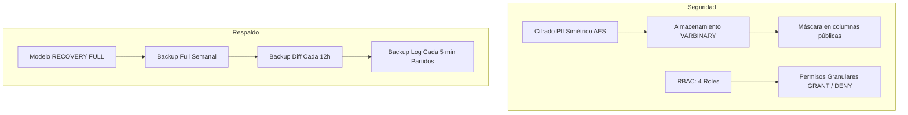

# Guía Integral de Defensa Oral (Coloquio) - Sistema Mundial de Fútbol

**Asignatura:** 3641 – Bases de Datos Aplicadas  
**Universidad Nacional de La Matanza (UNLaM)**  
**Comisión:** 01-2900 | **Grupo:** 05  
**Docentes:** HNATIUK, JAIR EZEQUIEL; PALOMARES, LUIS ALFONSO  
**Alumno / Expositor:** Denis Abner Chungara Tenorio  

---

## 1. Visión General del Proyecto (Elevator Pitch para el Inicio)

> [!NOTE]
> **Cómo abrir la presentación ante los docentes:**
> *"El objetivo del proyecto fue diseñar e implementar una solución integral y centralizada en SQL Server (T-SQL) para la gestión operativa y comercial de la Copa del Mundo de Fútbol. La arquitectura desacopla el sistema en cuatro esquemas de negocio (`nucleo`, `jugadores`, `eventos`, `publicidad`), garantizando integridad referencial, trazabilidad de incidencias en tiempo real, importación masiva ETL, generación de reportes analíticos avanzados (tabulares y XML) y un módulo robusto de seguridad con cifrado PII, control de acceso basado en roles (RBAC) y una política de respaldos con RPO crítico de 5 minutos."*

---

## 2. Arquitectura de Base de Datos y Decisiones de Diseño

### 2.1 Esquemas Lógicos (Modularización)
* **`nucleo`**: Catálogos base (confederaciones, países, ciudades, sedes, fases, grupos), selecciones, cuerpo técnico, fixture de partidos, designaciones y sanciones arbitrales.
* **`jugadores`**: Gestión de clubes, padrón de jugadores, listas de buena fe (convocatoria oficial), altas/bajas de último momento, formaciones tácticas (titulares y suplentes) y sustituciones.
* **`eventos`**: Registro minuto a minuto de incidencias (goles, tipos de definición, asistencias, tarjetas amarillas/rojas), reglas parametrizables de suspensión y tablas de staging/log para importación masiva.
* **`publicidad`**: Catálogo de monedas, anunciantes, piezas publicitarias, matriz de franjas y la asignación inteligente de los 4 espacios perimetrales por partido según audiencia y prime time.

### 2.2 Estrategia de Idempotencia y Orquestación
* **`00_Reset_Total.sql` (Script Maestro):**
  * Elimina conexiones activas (`ALTER DATABASE ... SET SINGLE_USER WITH ROLLBACK IMMEDIATE`) y recrea la base desde cero.
  * Crea los 4 esquemas de forma aislada.
  * Ejecuta de manera secuencial y numerada del `01` al `29` mediante la directiva `:r $(RUTA)\...` en modo SQLCMD.
  * Valida existencia previa de cada objeto antes de crear/borrar (`IF OBJECT_ID(...) IS NULL / CREATE OR ALTER`).
* **`06_FK_Cruzadas.sql` (Resolución de Dependencias Circulares):**
  * **Por qué se hace así:** En lugar de definir todas las claves foráneas dentro de los `CREATE TABLE`, las FK que cruzan esquemas (ej: `Convocatoria` a `Seleccion`, `EspacioPublicitario` a `Partido`) se postergan hasta que todas las tablas existan. Esto previene errores de compilación y dependencias cíclicas.
* **`00_Ejecutar_Tests.sql` (Orquestador Maestro de Testing):**
  * Ejecuta los tests en orden cronológico con control de transacciones (`WHILE @@TRANCOUNT > 0 ROLLBACK TRANSACTION;`).
  * Evita que un test fallido o abortado deje transacciones colgadas o ensucie el estado para los tests siguientes.

---

## 3. Módulos Críticos y Reglas de Negocio (Preguntas Clave del Coloquio)

### 3.1 Módulo Arbitral (`08_SP_ControlArbitral.sql`)
* **Regla de conflicto de nacionalidad:** Un árbitro **no puede** ser designado para un partido donde juegue la selección de su mismo país.
* **Advertencia de cruce en eliminatorias:** A partir de dieciseisavos de final, si el país del árbitro sigue en competencia en el mismo cuadro o podría cruzarse con los equipos en cancha, el SP emite un aviso de advertencia preventivo.

### 3.2 Convocatorias, Formaciones y Sustituciones (`14` a `17`)
* **Convocatoria oficial:** Valida cupo mínimo y máximo reglamentario (ej. entre 23 y 26 jugadores) según `jugadores.ReglaConvocados`.
* **Altas y bajas por lesión:** Transacción atómica en `SP_REGISTRAR_BAJA_CONVOCATORIA` que da de baja al lesionado y, opcionalmente en la misma unidad de trabajo, da de alta al jugador sustituto.
* **Formaciones titulares:** Valida esquema táctico válido (ej. 4-3-3: 1 Arquero, 4 Defensores, 3 Mediocampistas, 3 Delanteros) y exactamente 11 jugadores titulares, con dorsales del 1 al 99 no repetidos por equipo.
* **Sustituciones (Control de ventanas):**
  * Tiempo regular: Máximo 5 sustituciones en hasta 3 ventanas de cambios.
  * Tiempo suplementario: Habilita 1 cambio adicional y 1 ventana extra.
* **Reconstrucción de equipo en cancha:** Función `jugadores.fn_JugadoresEnCancha(@idPartido, @idSeleccion, @minuto)` calcula quiénes estaban jugando exactamente en un minuto determinado, cruzando titulares y sustituciones previas a ese minuto.

### 3.3 Eventos de Juego y Suspensiones (`10` a `13`)
* **Goles:** Registra autor, asistente (opcional), minuto, período y tipo (Jugada, Cabeza, Penal, Tiro Libre, En Contra). Si es gol en contra, no se computa como asistencia ni gol individual en la tabla de goleadores.
* **Suspensiones automáticas:** Función `eventos.fn_EstaSuspendido`:
  * Expulsión por roja directa: suspensión según regla parametrizada (mínimo 1 o 2 partidos).
  * Expulsión por doble amarilla: suspensión de 1 partido.
  * Acumulación de amarillas: Se parametrizan las amarillas consecutivas en partidos diferentes para inhabilitar al jugador en la formación del partido subsiguiente.

### 3.4 Motor de Publicidad y Prime Time (`20` y `21`)
* **Capacidad estricta:** Exactamente **4 espacios rotativos** por partido.
* **Criterio de priorización de piezas (en cascada):**
  1. *Afinidad de Selección:* Piezas dirigidas a los países de las selecciones que disputan el encuentro.
  2. *Poder Adquisitivo:* Mercados con mayor PBI per cápita según datos macroeconómicos.
  3. *Horario Prime Time:* Franja donde la hora local del país receptor cae entre las 19:00 y las 23:00 (calculado dinámicamente desde `FechaHoraUTC` y el huso horario registrado en `nucleo.Pais` / `nucleo.Ciudad`).
* **Facturación histórica:** Cada asignación registra la tarifa cobrada y la moneda correspondiente.

---

## 4. Procesos ETL y Reportes Analíticos

### 4.1 Importación Masiva (`23` y `24`)
* **Formatos procesados:** XML para planteles y convocatorias; CSV para eventos de partido.
* **Lógica de Upsert:** En lugar de `MERGE` monolítico (desaconsejado por bloqueos de concurrencia), se implementa validación de existencia por clave natural (ej. `Documento` o clave compuesta) haciendo `INSERT` si no existe o `UPDATE` si ya está registrado.
* **Resiliencia ante errores:** Uso de tablas de staging (`eventos.Staging_Eventos`) y registro de logs (`eventos.Log_Importacion`). Los registros con error de formato se loguean y se descartan, pero se permite la importación parcial de los registros correctos sin abortar todo el archivo.

### 4.2 Reportes Avanzados (`29_SP_Reportes.sql`)
1. **Goleadores:** Tabla clasificada con `DENSE_RANK()` por goles y asistencias, discriminando por fase y goles de equipo.
2. **Tarjetas y suspensiones:** Jugadores sancionados y detalle de inhabilitaciones vigentes.
3. **Designaciones arbitrales (XML #1):** Documento XML estructurado generado mediante `FOR XML PATH` / `FOR XML RAW` mostrando árbitros y partidos dirigidos.
4. **Ocupación publicitaria:** Reporte de los 4 espacios por encuentro e ingresos discriminados por moneda.
5. **Matriz de Prime Time (PIVOT Estático):** Tabla cruzada de partidos vs. mercados internacionales sin recurrir a SQL dinámico.
6. **Selecciones y Plantillas (XML #2):** Jerarquía XML anidada con selecciones, cuerpo técnico y vector de convocados.
7. **Resultados de Encuentros:** Fixture cronológico completo con horario UTC y conversión al horario local de la sede.

---

## 5. Módulo de Seguridad y Respaldo (Entrega 8)

### 5.1 Cifrado de Datos Personales (PII)
* **Campos protegidos:** `Documento` en `jugadores.Jugador`; `NombreApellido` en `nucleo.Arbitro` y `nucleo.StaffTecnico`.
* **Mecanismo:** Funciones `nucleo.fn_CifrarTexto` y `nucleo.fn_DescifrarTexto` basadas en cifrado simétrico AES mediante frase canónica.
* **Script modificatorio:** Se aplicó `ALTER TABLE` agregando columnas `VARBINARY` (`DocumentoCifrado`), se migraron los datos y se enmascaró la columna pública (`***-1234`).
* **Por qué falla el testing anterior:** Las consultas que buscaban texto plano directo (`WHERE Documento = '12345678'`) devuelven 0 filas porque el dato sensible ya no reside en texto legible. Solo los procedimientos autorizados de descifrado acceden al valor original.

### 5.2 Roles y Permisos Granulares (RBAC)
* **`Rol_Administrador`:** Control total (`GRANT CONTROL`) sobre los 4 esquemas.
* **`Rol_OperadorResultados`:** `EXECUTE` en carga de goles, tarjetas, alineaciones y sustituciones; `DENY` explícito sobre pauta publicitaria y backups.
* **`Rol_GestorPublicidad`:** `EXECUTE` en asignación de publicidad, contratos y reportes de ocupación; `DENY` sobre eventos deportivos.
* **`Rol_Consulta`:** Acceso de solo lectura y ejecución de reportes; `DENY` terminante de `INSERT`, `UPDATE`, `DELETE` directo y ABMs.
* **Testing:** Se prueba cada rol con `EXECUTE AS USER = 'usr_...'`, comprobando operaciones exitosas y atrapando con `TRY...CATCH` el **Error 229** (*permission denied*) en las denegadas.

### 5.3 Política de Respaldo y RPO/RTO
* **Escenario de negocio:** Durante partidos, se registran eventos críticos segundo a segundo. Una caída no puede perder goles o sanciones.
* **RPO (Pérdida máxima tolerable):** **5 minutos** en días de partido; 30 minutos fuera de competencia.
* **RTO (Tiempo de recuperación):** **30 minutos**.
* **Estrategia técnica:**
  * Modo de recuperación: `FULL`.
  * Backup Full: Semanal o nocturno fuera de partidos.
  * Backup Diferencial: Cada 12 horas (previo a la jornada).
  * Backup de Log: Cada **5 minutos** durante horario de partidos.
* **Compatibilidad:** Procedimientos adaptados dinámicamente para ejecutarse en SQL Server Express (sin `COMPRESSION`) y Developer/Enterprise (con `COMPRESSION`).

---

## 6. Guía Rápida para la Demo en Vivo del Coloquio

Si el docente te pide compartir pantalla y ejecutar en vivo:

1. **Abrir SSMS y activar Modo SQLCMD:**  
   * Menú *Consulta → Modo SQLCMD*.
2. **Recreación desde cero:**  
   * Abrir `scripts/creacion/00_Reset_Total.sql`.
   * Verificar la variable `:setvar RUTA ...` con tu ruta local.
   * Ejecutar (`F5`).
   * **Qué decir:** *"El script maestro recrea la base de datos limpia, genera los 4 esquemas y corre los 32 scripts en orden secuencial, terminando con la tabla resumen de objetos por esquema."*
3. **Ejecución del orquestador de pruebas:**  
   * Abrir `scripts/testing/00_Ejecutar_Tests.sql`.
   * Ejecutar (`F5`, preferentemente con Ctrl+T a texto).
   * **Qué decir:** *"El orquestador corre los casos de prueba unitarios y de integración de cada módulo, limpia transacciones entre pruebas y verifica que no queden datos basura al finalizar."*
4. **Demostración de Cifrado y Roles:**  
   * Mostrar un `SELECT TOP 5 Documento, DocumentoCifrado FROM jugadores.Jugador;` para exhibir el dato enmascarado y los bytes cifrados.
   * Ejecutar `31_Test_Rol_OperadorResultados.sql` para mostrar la captura del Error 229 cuando un operador intenta acceder a publicidad.
5. **Demostración de Backups:**  
   * Ejecutar `EXEC nucleo.SP_CONSULTAR_HISTORIAL_BACKUPS;` para mostrar en pantalla los respaldos Full, Diff y Log generados con sus marcas de tiempo en `msdb`.

---

## 7. Preguntas Frecuentes de la Cátedra y Respuestas Modelo

### P1: *"¿Por qué separaron las claves foráneas cruzadas en el script 06 en vez de ponerlas en las tablas?"*
> **Respuesta:** *"Para desacoplar los módulos y evitar problemas de dependencias circulares. Al crear las tablas en sus scripts individuales (núcleo, jugadores, eventos, publicidad), se compilan sin fallar por objetos inexistentes. En el script 06, cuando todas las entidades base ya existen, se aplican los `ALTER TABLE ADD CONSTRAINT` que interconectan el modelo."*

### P2: *"¿Por qué no usaron la sentencia MERGE para los procesos de importación y upsert?"*
> **Respuesta:** *"La sentencia `MERGE` en SQL Server tiene problemas conocidos de concurrencia y bloqueos agresivos (*deadlocks*) bajo alto volumen de datos. En su lugar, implementamos una lógica explícita de verificación por clave natural: si el registro existe se actualiza mediante un `UPDATE`, y si no existe se ejecuta el `INSERT` dentro de la transacción, logrando mayor control y trazabilidad en los logs de staging."*

### P3: *"¿Por qué una consulta previa de testing puede fallar tras aplicar la Entrega 8?"*
> **Respuesta:** *"Porque el script 30 es modificatorio: añade columnas binarias `VARBINARY`, migra los documentos y enmascara la columna original en texto plano (ej. `***-3999`). Si un test anterior hacía `WHERE Documento = '40123999'`, no encontrará registros directamente en la tabla, requiriendo el uso de las funciones o procedimientos autorizados de descifrado."*

### P4: *"¿Cómo justifican un RPO de 5 minutos y cómo se garantiza en SQL Server?"*
> **Respuesta:** *"En un Mundial de Fútbol, los partidos tienen picos intensivos de escritura en tiempo real. Perder más de 5 minutos de datos podría significar perder el registro oficial de un gol, una expulsión o un cambio por lesión. Para garantizarlo, configuramos la base en `RECOVERY FULL` y programamos respaldos de registro de transacciones (`BACKUP LOG`) cada 5 minutos durante la ventana de partidos."*
